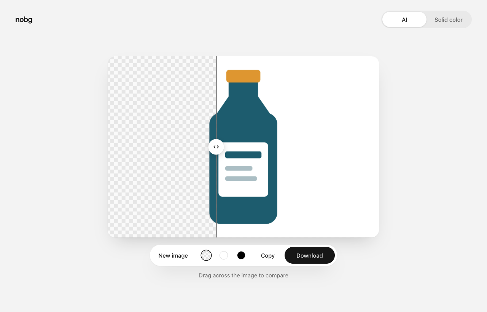

# nobg

Self-hosted background remover with its own web interface, built on [rembg](https://github.com/danielgatis/rembg).

| Mode | Use it for | How it works |
| --- | --- | --- |
| AI | Complex or unknown backgrounds | `isnet-general-use` segmentation model |
| Solid color | Product shots on a solid background | Color threshold on pixels connected to the image border, enclosed areas optional, no model |

Drop an image anywhere on the page, paste it, or drag one in from another website. The cutout appears in place, with a handle to compare it against the original. Download or copy it as a PNG on a transparent, white or black background.



## Run

Requires [uv](https://docs.astral.sh/uv/).

```bash
uv run remove_bg.py        # http://localhost:7860
uv run test_remove_bg.py   # self-check
```

With Docker:

```bash
docker compose -f docker-compose.local.yml up --build
```

The AI model (about 180 MB) downloads on first use of AI mode. Solid color mode never needs it.

## Configuration

| Variable | Default | Purpose |
| --- | --- | --- |
| `APP_AUTH` | unset | `user:password` enables the built-in login (HTTP Basic) |
| `U2NET_HOME` | `/models` in the image | Model cache directory |
| `PORT` | `7860` | Port the app listens on |
| `HOST` | `127.0.0.1`, `0.0.0.0` in the image | Address the app listens on |

## Limits

- Images over 40 megapixels are refused.
- Accepted formats are PNG, JPEG, WebP, GIF, BMP and AVIF.
- Uploaded images are held in memory for up to 30 minutes, so settings can change without a new upload. Nothing is written to disk.
- Uploads over 100 MB and URL fetches over 50 MB are refused.
- URL fetches accept only `http` and `https` and only publicly routable hosts.
- AI mode peaks at about 1.6 GB RAM on a 12 MP image. The container limit is 3 GB.
- `birefnet-general` gives cleaner edges but needs 8 to 13 GB RAM, so it is not used.

## Deploy

A push to `main` runs `.github/workflows/deploy.yml`. Pull requests run only step 1.

1. `test_remove_bg.py` runs. A failure stops the deploy.
2. GitHub builds the `linux/amd64` image.
3. The image is pushed to `ghcr.io/pyvnoaim/nobg` as `:latest` and `:sha-<short>`.
4. The Dokploy webhook (repo secret `DOKPLOY_WEBHOOK`) triggers a redeploy.

`docker-compose.yml` is the exact file Dokploy runs. To roll back, point the image at an older `:sha-` tag and redeploy.

## Reverse proxy

The container publishes no host port. It joins the external `websites` network and is reached as `remove-bg:7860`.

The proxy must provide:

- 100 MB request bodies and 300 s timeouts. AI mode on a slow CPU can pass the usual 60 s.
- Authentication, unless `APP_AUTH` is set. Use one or the other, since both are HTTP Basic and a browser sends only one login.

Plain HTTP is enough. The page needs no WebSockets.

For nginx or Nginx Proxy Manager (Advanced tab):

```nginx
client_max_body_size 100m;
proxy_read_timeout 300s;
proxy_send_timeout 300s;
```

With a Nginx Proxy Manager Access List, add `Allow 0.0.0.0/0` under Rules. An empty rule list denies everyone with a `403`.

To debug without the proxy, add `ports: ["127.0.0.1:7860:7860"]` to the stack and open an SSH tunnel to port 7860.

## License

[MIT](LICENSE)
